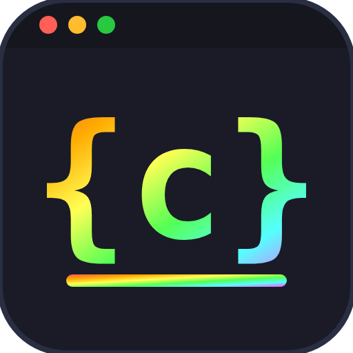
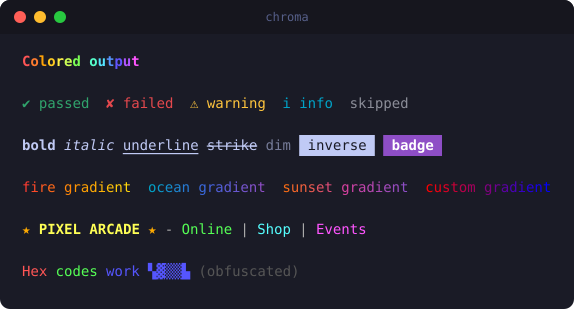
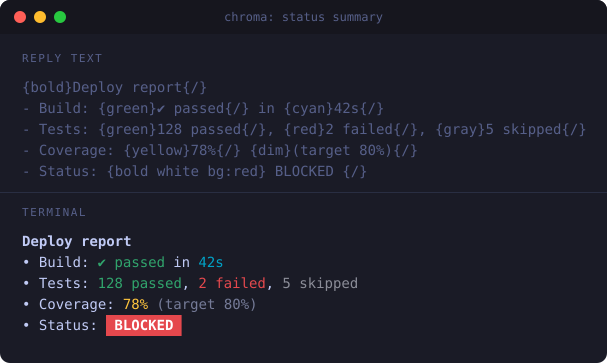
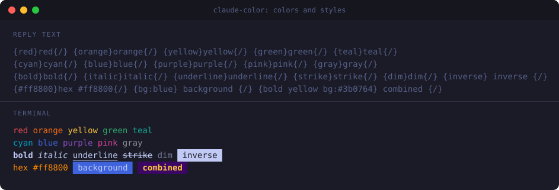
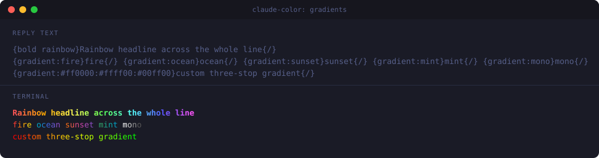
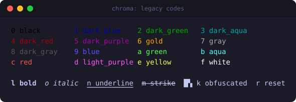
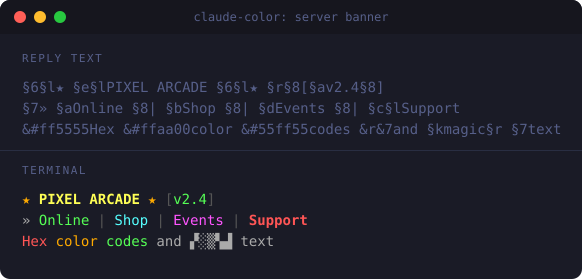
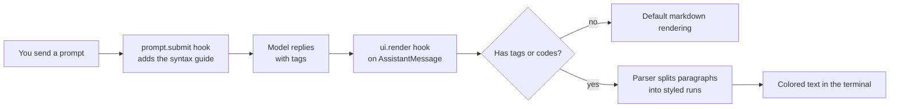

<p align="center">
  
</p>

<h1 align="center">chroma</h1>

<p align="center">
  Colors, styles, gradients and legacy formatting codes for Claude Code replies.
</p>

<p align="center">
  
  
  
  
</p>

<p align="center">
  
</p>

## Contents

- [Features](#features)
- [Installation](#installation)
- [Usage](#usage)
- [Syntax reference](#syntax-reference)
- [legacy codes](#legacy-codes)
- [Commands](#commands)
- [Configuration](#configuration)
- [How it works](#how-it-works)
- [Limitations](#limitations)
- [Troubleshooting](#troubleshooting)
- [Development](#development)
- [License](#license)

## Features

| Feature | Example | Result |
| --- | --- | --- |
| Named colors | `{green}passed{/}` | 12 colors plus every classic color name |
| Hex colors | `{#ff8800}text{/}` | Any 3- or 6-digit hex color |
| Text styles | `{bold}`, `{italic}`, `{underline}`, `{strike}`, `{dim}`, `{inverse}` | Combine freely |
| Backgrounds | `{bg:red}` | Badges and highlights |
| Combined tags | `{bold white bg:red} BLOCKED {/}` | Several styles in one tag |
| Gradients | `{rainbow}`, `{gradient:fire}`, `{gradient:#f00:#00f}` | Per-character color blend with any number of stops |
| legacy codes | `§6§lGOLD`, `&aGreen`, `&#ff5555Hex`, `§x§f§f§0§0§0§0` | Full legacy, ampersand, hex and long hex support |
| Obfuscated text | `§kmagic` | Scrambled glyphs like the `§k` effect |
| Markdown kept | headings, lists, bold, italic, strike, inline code | Works inside colored paragraphs too |
| Safe by default | code blocks, inline code, tables, `R&D`, `a=1&b=2`, `&amp;` | Never colored or misread |
| Model aware | short syntax guide added to each prompt | Replies use color on their own |

## Installation

**Requirements:** Claude Code with plugin hooks modules (tested on `2.1.331`).

### Option 1: from the marketplace (recommended)

Run inside Claude Code:

```text
/plugin marketplace add Dev-Sebi/Claude-Color
/plugin install chroma@dev-sebi
```

Or from your shell:

```bash
claude plugin marketplace add Dev-Sebi/Claude-Color
claude plugin install chroma@dev-sebi
```

Pick the **user** scope to have it in every session. The mod is active right away.

### Option 2: from a local clone

```bash
git clone https://github.com/Dev-Sebi/Claude-Color.git
claude --plugin-dir ./Claude-Color
```

To load it in every session without the flag, add the folder to `CLAUDE_CODE_PLUGIN_DIRS` in the `env` block of `~/.claude/settings.json`:

```json
{
  "env": {
    "CLAUDE_CODE_PLUGIN_DIRS": "/absolute/path/to/Claude-Color"
  }
}
```

### Updating

```bash
claude plugin marketplace update dev-sebi
claude plugin update chroma@dev-sebi
```

Then run `/reload-plugins` in open sessions.

### Uninstalling

```bash
claude plugin uninstall chroma@dev-sebi
```

### Check that it works

1. Run `/color demo`. You should see the colored demo from the top of this page.
2. Ask for something like *"give me a colored status summary"*.

## Usage

You do not need to type any tags yourself. The mod teaches the model the syntax, so replies color status words, key values and warnings on their own. You can also ask for a style directly: *"answer as a server banner"*, *"use a rainbow headline"*.

<p align="center">
  
</p>

## Syntax reference

### Colors and styles

| Tag | Effect |
| --- | --- |
| `{red}` `{orange}` `{yellow}` `{green}` `{teal}` `{cyan}` `{blue}` `{purple}` `{pink}` `{gray}` `{white}` `{black}` | Named color |
| `{gold}` `{aqua}` `{dark_red}` `{light_purple}` ... | Any [classic color name](#legacy-codes) |
| `{#ff8800}` `{#f80}` | Hex color |
| `{bold}` / `{b}` | Bold |
| `{italic}` / `{i}` | Italic |
| `{underline}` / `{u}` | Underline |
| `{strike}` / `{s}` | Strikethrough |
| `{dim}` | Dimmed |
| `{inverse}` | Swaps text and background color |
| `{obfuscated}` / `{magic}` | Scrambled glyphs |
| `{bg:<color>}` | Background color (name or hex) |
| `{bold red bg:black}` | Several tokens in one tag |

<p align="center">
  
</p>

### Gradients

| Tag | Effect |
| --- | --- |
| `{rainbow}` | Rainbow over the tagged text |
| `{gradient:fire}` | Preset: `fire`, `ocean`, `sunset`, `mint`, `mono`, `rainbow` |
| `{gradient:#ff0000:#0000ff}` | Custom gradient, two or more stops (names or hex) |

<p align="center">
  
</p>

### Closing and escaping

| Syntax | Effect |
| --- | --- |
| `{/}` or `{/red}` | Closes the last opened tag |
| `{/*}` | Closes every open tag |
| `{reset}` | Closes every tag and clears legacy codes |
| `\{red}` | A literal `{red}`, not a tag |
| `\§a`, `\&a` | A literal legacy code |

Tags nest: `{red}red {bold}red and bold{/} red{/}`. Unknown tags such as `{name}` stay as written, so normal braces in text are safe.

## legacy codes

Both `§` and `&` work. A color code resets the format codes before it, and every line starts fresh.

<p align="center">
  
</p>

| Code | Name | Hex | | Code | Name | Hex |
| --- | --- | --- | --- | --- | --- | --- |
| `§0` | black | `#000000` | | `§8` | dark_gray | `#555555` |
| `§1` | dark_blue | `#0000aa` | | `§9` | blue | `#5555ff` |
| `§2` | dark_green | `#00aa00` | | `§a` | green | `#55ff55` |
| `§3` | dark_aqua | `#00aaaa` | | `§b` | aqua | `#55ffff` |
| `§4` | dark_red | `#aa0000` | | `§c` | red | `#ff5555` |
| `§5` | dark_purple | `#aa00aa` | | `§d` | light_purple | `#ff55ff` |
| `§6` | gold | `#ffaa00` | | `§e` | yellow | `#ffff55` |
| `§7` | gray | `#aaaaaa` | | `§f` | white | `#ffffff` |

| Code | Effect |
| --- | --- |
| `§l` | Bold |
| `§o` | Italic |
| `§n` | Underline |
| `§m` | Strikethrough |
| `§k` | Obfuscated |
| `§r` | Reset |
| `&#RRGGBB` / `§#RRGGBB` | Hex color |
| `§x§R§R§G§G§B§B` | Long hex color |

`&` codes only count at the start of a word, so `R&D`, `a=1&b=2` and `&amp;` stay plain text.

<p align="center">
  
</p>

## Commands

| Command | Effect |
| --- | --- |
| `/color` or `/color help` | Colored cheat sheet |
| `/color demo` | Shows every feature at once |
| `/color off` | Turns colors and the model guide off (saved across sessions) |
| `/color on` | Turns them back on |

## Configuration

Set the options in the plugin's config menu (`/plugin`), or under `pluginConfigs` in `~/.claude/settings.json`:

```json
{
  "pluginConfigs": {
    "chroma": {
      "teachModel": true,
      "legacyCodes": true
    }
  }
}
```

| Option | Default | Effect |
| --- | --- | --- |
| `teachModel` | `true` | Adds a short syntax guide to each prompt, so replies use colors on their own. Turn it off to color only when you ask for it in your own words. |
| `legacyCodes` | `true` | Draws `§` and `&` codes. Turn it off if your replies often contain `§` (law texts, for example). |

## How it works



- `hooks/format.ts` is a pure parser: text in, styled runs out. It never touches code blocks, inline code or tables.
- `hooks/register.tsx` wires it into Claude Code: the prompt hook, the `/color` command and the renderers for replies and command output.
- Only the drawing changes. The stored conversation keeps the raw tags, so `ctrl+o` and exports show the original text.

## Limitations

- A paragraph with tags is drawn as styled text. Links and nested lists inside **that** paragraph show as plain text. Paragraphs without tags render exactly as before.
- Tables are never colored: tags inside tables are removed and the table renders normally.
- `§k` obfuscated text is scrambled once, it does not animate.
- The images on this page are rendered from the real parser with `scripts/render-examples.ts`. The exact colors and fonts in your terminal depend on its theme.
- Terminals without true color support show the nearest available color.

## Troubleshooting

| Problem | Fix |
| --- | --- |
| Tags show as plain text like `{red}` | Run `/color on`, then `/reload-plugins`. Check `claude plugin list` shows `chroma` as enabled. |
| Replies have no colors at all | `teachModel` may be off, or the prompt hook is blocked by another plugin. Ask for colors explicitly to test the renderer. |
| `§` in normal text turns into colors | Set `legacyCodes` to `false`, or escape it as `\§`. |
| A hook was skipped | Start with `claude --debug` and look for lines starting with `chroma:`. |

## Development

```bash
git clone https://github.com/Dev-Sebi/Claude-Color.git
cd Claude-Color

claude plugin validate .            # manifest and hooks check
claude plugin test .                # 21 tests: parser and rendering
node scripts/render-examples.ts     # regenerates docs/images/*.svg (Node 22.18+)
claude --plugin-dir .               # try it, saves reload on their own
```

Project layout:

```text
.claude-plugin/
  plugin.json          manifest and options
  marketplace.json     lets people install from this repository
  icon.png
hooks/
  hooks.json           names the hooks module
  register.tsx         hooks: prompt guide, /color command, renderers
  format.ts            parser: tags, gradients, legacy codes, markdown
  samples.ts           /color demo and cheat sheet text
  *.test.ts(x)         tests
scripts/
  render-examples.ts   builds the README images from the parser
  examples.ts          the example texts
docs/images/           generated images
```

See [CONTRIBUTING.md](CONTRIBUTING.md) before opening a pull request.

## License

[MIT](LICENSE) © Dev-Sebi
